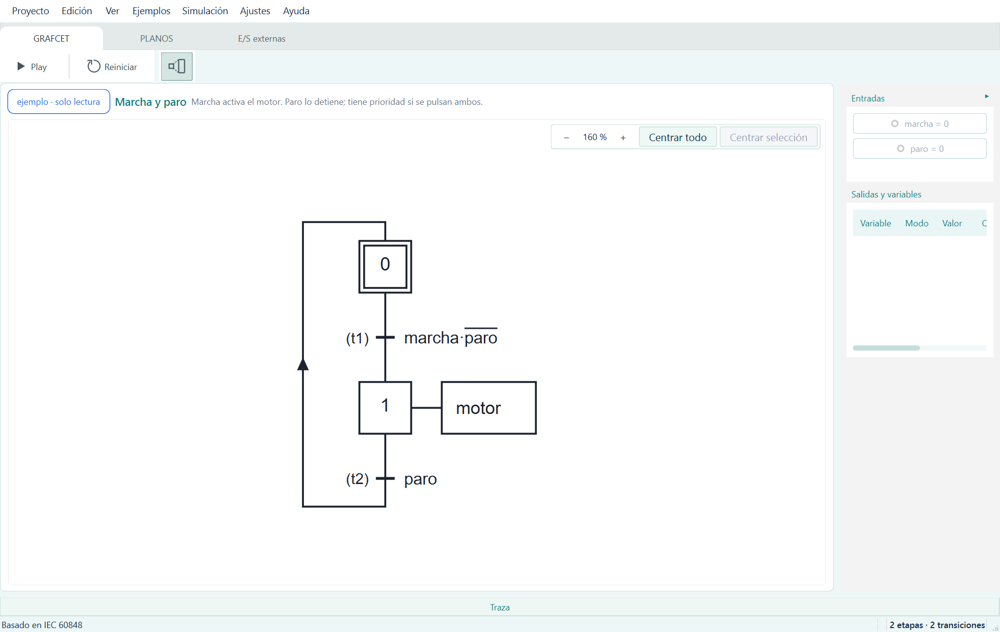
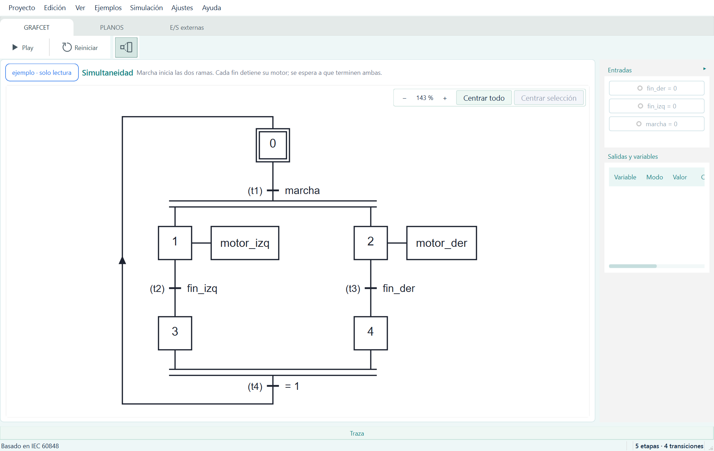

# GRAFCET Connect

Editor y simulador de GRAFCET, basado en IEC 60848, con conexión Modbus TCP a simuladores de procesos.

Pensado para quien aprende, enseña o trabaja con automatización. Permite dibujar un grafcet, simularlo con entradas pulsables, documentarlo en planos con cajetín y, si hace falta, conectarlo a un simulador de procesos por Modbus TCP. Es una herramienta de aprendizaje y consulta: no es una declaración de conformidad con la norma.

**Contenido:** [Características](#características) · [Descargar e instalar](#descargar-e-instalar) · [Primeros pasos](#primeros-pasos) · [Ejemplos incluidos](#ejemplos-incluidos) · [Preguntas frecuentes](#preguntas-frecuentes) · [Comunicar un fallo](#comunicar-un-fallo) · [Licencia](#licencia) · [Para desarrolladores](#para-desarrolladores)

## Características

### Edición

- Paleta con etapa, transición, simultaneidad (barra de doble trazo), acción, macroetapa, encapsulante, grafcet parcial y orden de forzado. Cada elemento se arrastra al dibujo.
- Enlaces trazados con el ratón desde los puntos de unión, con selección de secuencia, salto de etapas y repetición. Los retornos llevan su flecha y se recolocan a mano.
- Receptividades, condiciones y eventos con un programador de bloques, o escritos a mano.
- Acciones continuas, condicionadas, al activar, al desactivar y por evento. Tipos de etapa (etapa, etapa inicial, encapsulante, macroetapa) desde el botón derecho.
- Girar la evolución a través de una transición (en sentido horario o antihorario; menú contextual, Editar o Ctrl+Mayús+←/→), con los tramos de sus enlaces movibles: trazo vertical con enlaces horizontales y flecha cuando no va hacia abajo.
- Tabla de variables de entrada, salida y memoria, booleanas, enteras o decimales.
- Cortar, copiar y pegar (Ctrl+X, Ctrl+C, Ctrl+V), deshacer y rehacer, buscar elemento (Ctrl+F) y equidistanciar alturas.

### Simulación

- Play (F5) simula en tiempo real y Stop vuelve a editar. Reiniciar (Ctrl+R) vuelve a la situación inicial. Cada Play empieza desde la situación inicial.
- Las entradas son pulsadores: un clic para pulsar, Ctrl+clic para enclavar y clic derecho para interruptor. Las numéricas se escriben.
- Las etapas activas se ven en el dibujo; las salidas, las variables y las entradas, en el panel lateral; la traza, en el panel inferior.
- Los temporizadores muestran el tiempo transcurrido y una marca al vencer.
- En **Ajustes > Ajustes de simulación…** se elige cuándo vale el cambio de una entrada: «De uno en uno» (por defecto) o «Todo de una vez».
- Los avisos usan vocabulario GRAFCET. Los diagnósticos se resumen en el panel de la derecha.

### Documentación y planos

- Pestaña **PLANOS**: hojas con cajetín, con **+ Añadir hoja**, **Traer GRAFCET** (copia a una hoja los elementos seleccionados) y **Añadir texto**.
- **Importar plantillas de lámina** desde **Lámina > Importar plantilla…**. Se admiten:
  - **DXF**: el cajetín y sus campos pasan a ser editables.
  - **PDF**: se elige la página; los textos extraíbles son editables y el resto queda como fondo.
  - **SVG**: queda como fondo, sin campos editables.
  - **JSON** de GRAFCET Connect: una plantilla guardada antes.
- Plantillas predeterminadas A4 (vertical), A3 (horizontal y vertical) y A2, A1 y A0 en ambas orientaciones. Desde **Lámina** también se edita una plantilla, se usa la estándar, se quita, se guarda en la biblioteca o se restaura la predeterminada.
- El cajetín (180 × 36 mm) incluye dibujado y comprobado (fecha, autor y firma), razón social, escala, nombre del plano, número, «sustituye a» y «sustituido por».
- **Proyecto > Exportar…** genera PDF o SVG (un SVG por hoja si hay varias). **Proyecto > Imprimir…** (Ctrl+P) imprime las hojas.
- **Proyecto > Guardar el dibujo como imagen…** guarda el grafcet como PNG.

### Conexión con simuladores de procesos

- Cliente Modbus TCP. El botón **E/S externas** de la barra abre la asignación: sensores a la izquierda y actuadores a la derecha.
- La fila de pestañas (GRAFCET, PLANOS) muestra, a la derecha del todo, la luz de conexión: verde si está conectada, gris si no lo está y rojo si hay un error. Es la entrada a **E/S externas**: un clic la abre (y queda resaltada mientras se ve); GRAFCET o PLANOS vuelven.
- **Configuración** reúne la IP, el puerto (502 por defecto), el esclavo y los canales del servidor (por defecto, 32 digitales y 12 numéricos, con offset y cantidad ajustables).
- Las variables nuevas se asignan solas a canales libres. También se pueden arrastrar a otro canal, y se quitan con la ×.
- **Conectar** pone a cero las salidas asignadas antes de la primera lectura. **Desconectar / editar** escribe el cero antes de cerrar la conexión.
- Las señales analógicas se llevan a variables Decimal con 2 decimales. Una variable Entera que recibe un valor con decimales se redondea al entero más cercano y lo indica con un aviso.

### Proyectos y archivos

- Cada proyecto es un único archivo `.grafnet`, con su dibujo, sus planos y la configuración de E/S.
- **Proyecto > Nuevo proyecto** (Ctrl+N), **Abrir…** (Ctrl+O), **Guardar** (Ctrl+S) y **Guardar como…** (Ctrl+Mayús+S).
- La firma del archivo indica si lo guardó esta versión sin cambios. No impide abrir ni guardar archivos sin firma. Véase [Preguntas frecuentes](#preguntas-frecuentes).
- **Proyecto > Propiedades del archivo…** muestra el autor (editable), las fechas, las versiones y la firma.
- Se guarda periódicamente una copia de recuperación.

## Descargar e instalar

Descargue el instalador de la última versión: [GRAFCET-Connect-setup.exe](https://github.com/SrLaguarto/GRAFCET-Connect/releases/latest/download/GRAFCET-Connect-setup.exe). Este enlace siempre baja la versión más reciente. Las notas de cada versión están en [Releases](https://github.com/SrLaguarto/GRAFCET-Connect/releases).

- **Requisitos:** Windows 10 o Windows 11 de 64 bits. No necesita conexión a internet para funcionar.
- **Instalación:** por defecto se instala en Archivos de programa, lo que pide permisos de administrador. Si no los tiene, el instalador ofrece instalarlo solo para su usuario. Crea el acceso en el menú Inicio, ofrece un acceso en el escritorio (desmarcado por defecto) y asocia los archivos `.grafnet` (marcado por defecto).
- **Aviso de Windows:** la primera vez puede aparecer «Windows protegió su PC», porque el programa no lleva firma digital de código. Pulse «Más información» y después «Ejecutar de todas formas». Esto ocurre también con el instalador.
- **Actualizaciones:** al arrancar, el programa consulta en segundo plano si hay una versión nueva publicada en GitHub y avisa en la barra de estado, con «Descargar» o «Ahora no». Se desactiva en **Ajustes > Buscar actualizaciones al arrancar**. Sin conexión no hace nada, y no descarga ni instala nada. **Ayuda > Buscar actualizaciones…** comprueba a mano.
- **Desinstalación:** desde Configuración > Aplicaciones.

## Primeros pasos

1. **Dibujar.** Abra un ejemplo desde **Ejemplos** o cree un proyecto con **Proyecto > Nuevo proyecto**. Arrastre elementos desde la paleta y únalos desde sus puntos de unión. Las variables se crean en la tabla de variables, con «Nueva E», «Nueva S» o «Nueva M». **Edición > Añadir elemento** y Ctrl+Intro (Añadir debajo) agilizan el dibujo.
2. **Simular.** Pulse **Play** (F5) y pulse las entradas del panel lateral. Para volver a editar, pulse **Stop**. Con **Reiniciar** (Ctrl+R) vuelve a la situación inicial.
3. **Documentar e importar una plantilla.** Abra la pestaña **PLANOS**, pulse **+ Añadir hoja** y elija la plantilla. Para usar una propia, vaya a **Lámina > Importar plantilla…** y elija un DXF, un PDF, un SVG o un JSON de GRAFCET Connect. Para exportar, use **Proyecto > Exportar…**.
4. **Conectar por Modbus.** Pulse **E/S externas**, abra **Configuración** para poner la IP, el puerto y el esclavo de su simulador de procesos, y asigne las variables a los canales. Después pulse **Conectar** y, luego, **Play**. La guía paso a paso está en [docs/PRIMERA_CONEXION_MODBUS.md](docs/PRIMERA_CONEXION_MODBUS.md).
5. **Guardar y firmar.** **Guardar** (Ctrl+S) guarda el proyecto con su dibujo. **Proyecto > Propiedades del archivo…** muestra los datos y la firma.

| Acción | Atajo |
|---|---|
| Play / Stop | F5 |
| Reiniciar | Ctrl+R |
| Deshacer / rehacer | Ctrl+Z / Ctrl+Y |
| Cortar, copiar, pegar | Ctrl+X, Ctrl+C, Ctrl+V |
| Borrar la selección | Supr |
| Añadir debajo | Ctrl+Intro |
| Buscar elemento | Ctrl+F |
| Conectar el elemento seleccionado con otro, sin ratón | Ctrl+K |
| Centrar todo el dibujo | Ctrl+0 |
| Acercar / alejar | Rueda del ratón (con o sin Ctrl), o Ctrl+= / Ctrl+- |
| Desplazar en horizontal | Mayús+rueda |
| Panel táctil | Dos dedos desplazan; pellizco acerca y aleja |
| Girar la transición seleccionada | Ctrl+Mayús+← / → |
| Mostrar u ocultar paneles izquierdo, derecho e inferior | Ctrl+L, Ctrl+B, Ctrl+J |
| Imprimir | Ctrl+P |

## Ejemplos incluidos

El menú **Ejemplos** trae siete ejemplos para el aula, listos para simular:

- **Marcha y paro**: marcha activa el motor; paro lo detiene.
- **Elección de secuencia**: elige izquierda o derecha; fin vuelve al inicio.
- **Simultaneidad**: marcha inicia dos ramas y se espera a que terminen ambas.
- **Macroetapa**: marcha entra en una macroetapa; fin completa su expansión.
- **Encapsulación**: una encapsulante con su recinto.
- **Temporización**: el motor funciona 3 s y después se enciende la luz.
- **Repetición de secuencia**: repetir vuelve al motor; fin termina si no se repite.

El submenú **Más ejemplos y casos de estudio** reúne otros dieciséis, entre ellos selección y salto de etapas, alternativas, contadores, paralelismo, forzado y conflictos de escritura.

*El ejemplo «Simultaneidad» en la vista de solo lectura: dos ramas que se sincronizan antes de volver al inicio.*

## Preguntas frecuentes

**¿Necesita internet?**
No. El programa funciona sin conexión. Solo usa la red si se conecta a un simulador de procesos por Modbus TCP, en la dirección IP que se configure.

**¿Por qué avisa Windows?**
El programa no lleva firma digital de código. Windows lo muestra la primera vez. Véase [Descargar e instalar](#descargar-e-instalar).

**¿Qué es la firma del archivo?**
Un sello que indica si el archivo `.grafnet` lo guardó esta versión del programa sin cambios. Un archivo sin firma se abre y se guarda con normalidad; la barra de estado lo indica y sigue sin firma al guardarlo.

**¿Por qué una variable Entera se redondea?**
Un simulador de procesos puede enviar valores con decimales. Una variable Entera los redondea al entero más cercano y avisa. Para conservar el valor exacto, use una variable Decimal con 2 decimales.

**¿Es gratis?**
El programa se distribuye con licencia GPL-3.0, que permite usarlo, estudiarlo, modificarlo y redistribuirlo. Para usos que la GPL no permita, el autor ofrece licencias comerciales bajo petición (véase [Licencia](#licencia)).

## Comunicar un fallo

Los fallos y las sugerencias se comunican en las [Issues de GitHub](https://github.com/SrLaguarto/GRAFCET-Connect/issues). Indique la versión (**Ayuda > Acerca de GRAFCET Connect…**, que tiene el botón **Comunicar un fallo**) y los pasos para reproducirlo.

## Licencia

GRAFCET Connect se publica con la licencia **GPL-3.0**; el texto completo está en el fichero [LICENSE](LICENSE). El autor ofrece además **licencias comerciales bajo petición** para usarlo en un producto o servicio que no pueda cumplir la GPL-3.0; se piden a través de [GitHub](https://github.com/SrLaguarto).

Las contribuciones se aceptan según [CONTRIBUTING.md](CONTRIBUTING.md). Las bibliotecas de Qt (PySide6, LGPL v3) van en el programa como ficheros separados. Sus textos y los de los demás componentes de terceros están en la carpeta `licencias/` del programa. El programa se ofrece sin ninguna garantía.

## Para desarrolladores

La estructura del código, las comprobaciones, la convención de commits y la procedencia están en [docs/DESARROLLO.md](docs/DESARROLLO.md). Para contribuir, véase [CONTRIBUTING.md](CONTRIBUTING.md).
