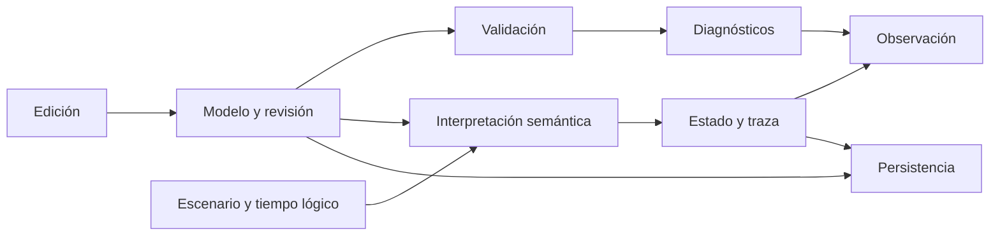

# 10. Arquitectura conceptual y multiplataforma

Versión 0.1 · Estado: requisitos P; presupuestos propuestos, no medidos.

## Propósito y referencias

Delimitar responsabilidades y aceptación sin elegir tecnología. Dependencias: [datos y contratos](09_Datos_y_contratos.md), [editor](07_Requisitos_del_editor.md), [simulación](08_Simulador_trazas_y_diagnostico.md). Fuente: ENC §14. Pendiente U-10: versiones de sistemas y equipo de referencia; U-11: ratificación de formato. Todo número de rendimiento es objetivo de producto propuesto, no resultado experimental.

## Responsabilidades y fronteras

| Responsabilidad | Recibe | Produce | Invariante |
|---|---|---|---|
| Modelo | Operaciones de edición declaradas | Revisión y relaciones | No depende de coordenadas para significado |
| Validación | Revisión, perfil y catálogo de capacidades | Diagnósticos y posibilidad de iniciar | No muta el documento ni completa huecos por defecto |
| Interpretación | Estado Z, estímulo y perfil cerrado | Evolución, resultado o error explicado | No depende de fotogramas ni orden de componentes visuales |
| Escenarios/reloj | Lotes, tiempos y controles | Contextos causales identificados | Tiempo reproducible, sin escaneo implícito |
| Persistencia | Documentos y estado íntegro | Archivos verificables | Guardado completo o anterior recuperable |
| Presentación | Proyecciones del modelo/estado | Diagrama y controles | Observación sin efectos semánticos |
| Diagnóstico | Evidencia y contratos | Explicaciones e incidencias | No corrige el modelo silenciosamente |
| Exportación | Revisión y vista elegida | Representación legible | Leyenda y revisión, sin contaminación de otra ejecución |

No se exige distribuir estas responsabilidades en procesos, servicios o clases concretas. Debe ser posible verificar el motor sin interfaz gráfica, utilizando los mismos contratos y perfiles que la aplicación. La libertad técnica termina donde cambia un observable del paquete.

Diagrama original de responsabilidades; las flechas representan intercambio de datos, no orden de ejecución ni evolución GRAFCET:

## Alternativas de distribución

Una aplicación de escritorio multiplataforma o una aplicación web instalable con ejecución local podrían satisfacer los contratos. La decisión depende de pruebas de acceso a archivos, recuperación, accesibilidad y rendimiento. El producto obligatorio funciona sin conexión una vez instalado; no exige servidor para simular. No se promete simultáneamente una edición web y otra nativa. La segunda IA debe justificar su elección antes de comprometer la matriz de sistemas, sin cambiar el significado del formato ni del motor.

## Matriz de aceptación

| Área | Windows | macOS | Linux | Criterio común |
|---|---|---|---|---|
| Versiones | Por ratificar U-10 | Por ratificar U-10 | Distribución y entorno por ratificar U-10 | Registrar versión exacta, arquitectura y entorno de prueba |
| Semántica | Mismo catálogo | Mismo catálogo | Mismo catálogo | Traza canónica idéntica para casos cerrados |
| Archivos | Rutas con espacios y Unicode | Mismos nombres visibles | Mismos nombres visibles | IDs internos ASCII; ninguna colisión por mayúsculas del sistema |
| Región | es-ES y en-US | es-ES y en-US | es-ES y en-US | Formato canónico usa punto y µs, independiente de interfaz |
| Teclado | Atajos adaptados | Modificador habitual adaptado | Atajos compatibles con entorno | Mismas acciones y deshacer atómico |
| Escalado | 100 %,150 %,200 % | Densidad normal/alta y 200 % | 100 %,200 % | Texto y símbolos sin pérdida de información ni foco |
| Fuentes | Conjunto disponible | Conjunto disponible | Conjunto disponible | Símbolos reconocibles, sin caracteres ausentes |
| Guardado | Interrupción y recuperación | Interrupción y recuperación | Interrupción y recuperación | Última revisión válida preservada |
| Sin conexión | Crear/abrir/simular/exportar | Igual | Igual | Sin solicitud de acceso externo obligatorio |
| Instalación | Usuario sin privilegios cuando sea viable | Igual | Igual | Instalación documentada, desinstalación conserva proyectos por defecto |
| Actualización | Reversión y formato versionado | Igual | Igual | Proyecto previo conservado; migración explícita |

Los ensayos se repiten con una ruta que contenga «Ensayo ñ», una etiqueta «válvula», y referencias que difieran solo en mayúsculas para comprobar que no se confunden. Los atajos del sistema no deben impedir completar operaciones mediante menús o teclado alternativo.

## Presupuestos propuestos

| Dimensión | Objetivo P | Medición futura / salida al superar |
|---|---|---|
| Modelo de referencia | 5 000 etapas, 5 000 transiciones, 10 000 acciones | Carga, guardado y validación; exceder soporte declarado produce diagnóstico |
| Variables | 10 000 | Consultas y validación tipada |
| Jerarquía | Profundidad 32, hasta 1 000 parciales | Desplegar/navegar y validar ciclos |
| Expresiones | Profundidad 64; 100 000 nodos totales | Rechazo previo por D-LIM-DATOS al superar |
| Escenario | 100 000 lotes | Importación, consulta y reproducción |
| Traza | 1 000 000 registros / 1 GiB, lo que llegue antes | Pausa D-TRAZA-LIM, sin truncamiento silencioso |
| Archivo individual | 100 MiB; proyecto 500 MiB sin trazas | Rechazo informado antes de aceptar contenido completo |
| Edición de vista | Respuesta p95 ≤100 ms en modelo de referencia | 100 operaciones repetidas tras calentamiento |
| Validación completa | ≤5 s | Cinco ejecuciones, mediana y máximo documentados |
| Abrir o guardar modelo | ≤5 s en almacenamiento local | Cinco repeticiones, datos conservados |
| Memoria | ≤2 GiB para modelo de referencia sin traza completa en memoria | Medición de pico y estado estable |
| No estabilización | 10 000 evoluciones explicativas por contexto, valor inicial | Pausa; límite configurable y persistido |

Estos límites son salvaguardas P; no limitan lo que GRAFCET significa. Superarlos no justifica perder etapas o cambiar tiempo. Si se amplían, debe actualizarse perfil y pruebas. El equipo de referencia todavía debe fijarse (CPU, RAM, almacenamiento, SO, versión de aplicación y condiciones); no se puede aprobar latencia sin él. El volumen máximo de registro no debe usarse para asegurar que toda combinación de máximos cabe simultáneamente en memoria: deben medirse conjuntos representativos y un caso combinado.

## Robustez

Abrir archivos malformados, referenciados fuera de raíz, demasiado profundos o con campos ejecutables desconocidos debe fallar de forma controlada. Los documentos no ejecutan código. Un error de exportación no altera el modelo. Ante cierre inesperado se conserva recuperación separada; al retomar se ofrece la última revisión íntegra, no una mezcla de guardados. Diagnósticos y trazas de prueba no deben depender de la hora del sistema para los resultados lógicos.

## Requisitos

| ID | Clase/prioridad | Obligación | Pruebas |
|---|---|---|---|
| REQ-ARQ-01 | P/crítica | Los contratos semánticos deben poder verificarse sin interfaz ni animación | T-23b, T-24a |
| REQ-PLT-01 | P/crítica | Sistemas admitidos deben producir iguales trazas canónicas | T-24a |
| REQ-PLT-02 | P/alta | Rutas, Unicode y configuración regional deben cumplir matriz | T-24b,c |
| REQ-PLT-03 | P/alta | Debe funcionar sin conexión y conservar proyectos en distribución/actualización | T-24d,e |
| REQ-PLT-04 | P/alta | Se deben medir presupuestos con equipo y metodología declarados antes de prometerlos | T-25a,d |
| REQ-ROB-01 | P/crítica | Límites de datos y tiempo de evolución deben diagnosticarse sin alterar significado | T-08a,b, T-25a |
| REQ-ROB-02 | P/crítica | Archivos y operaciones fallidas deben preservar última revisión válida y no ejecutar cargas | T-22d, T-25b,c |

## Evidencia de implementación requerida

Informe por plataforma con identificadores de modelo, escenario, perfil, equipo y versión; resultados de cada caso; tiempos y memoria medidos; trazas comparables; defectos abiertos. La equivalencia se verifica en todos los observables exigidos, incluidos efectos de transitorios, no solo en situación final. Esta fase únicamente especifica esa evidencia.
